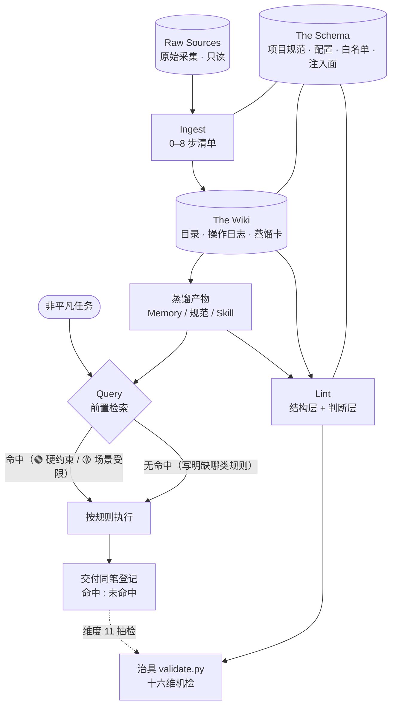
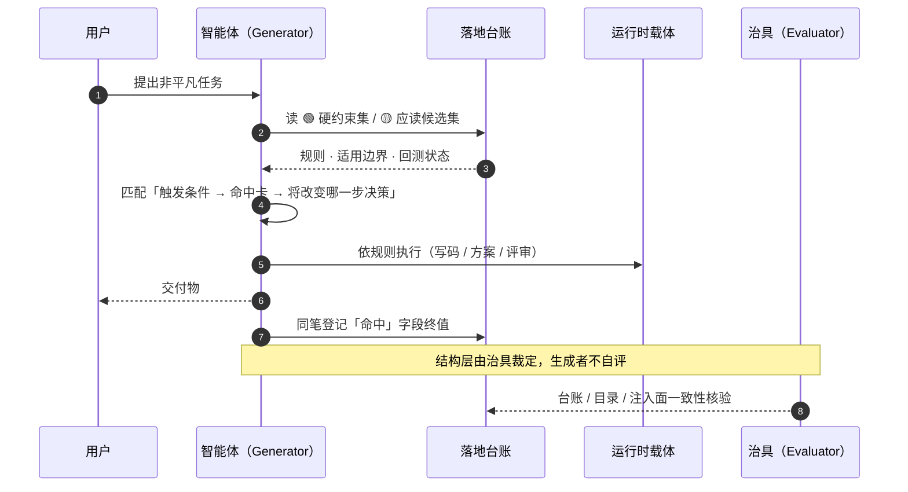

<div align="center">
  <h1>Agent Wiki — 智能体知识库运营工作流</h1>
  <p>平台无关的知识运营方法论 —— 采集入库 · 任务必经检索 · 知识库体检</p>
  <p>
    
    
    
    
  </p>
</div>

> **一句话定位**：知识库不是收藏夹，是智能体的能力增长引擎。本仓提供一套平台无关的方法论：把外部知识转化为智能体运行时可调用的行为规则（Memory／规范／Skill），以 `SKILL.md` 形式交付，首个验证平台为 Qoder。每条知识能否入库只有一条判据——**它能否改变智能体在具体场景下的行为决策**。

> **先看边界**：本仓是唯一可分发的 `agent-wiki` 源。发行包只含 `release-manifest.json` 的 `include` 清单所列 **23 个文件**；`README.md`、`tests/` 与 CI 配置留在仓内、不随包发行。只安装 `SKILL.md` 时你拿到的是方法论本体，Evaluator 需由你所在实例自带的校验器承担，或按 `SKILL.md` 的「Lint」节十六维人工核查。完整清单见[公开面边界](#公开面边界)。

## 目录

- [这是什么](#这是什么)
- [能力地图](#能力地图)
- [一次任务怎么走](#一次任务怎么走)
- [核心机制](#核心机制)
- [三色标记与质量过滤器](#三色标记与质量过滤器)
- [记忆分层与注入面](#记忆分层与注入面)
- [结构治具](#结构治具)
- [发行与实例锁](#发行与实例锁)
- [公开面边界](#公开面边界)
- [快速开始](#快速开始)
- [目录结构](#目录结构)
- [行尾前提](#行尾前提)
- [运行环境](#运行环境)
- [版本与迭代策略](#版本与迭代策略)
- [设计原则](#设计原则)
- [引用与署名](#引用与署名)
- [边界与免责声明](#边界与免责声明)

## 这是什么

按 Karpathy「LLM Wiki」模式运营智能体知识库：原始素材只读留存，Wiki 由 LLM 维护，Schema 由人与 LLM 共维；三个操作（Ingest／Query／Lint）都挂在任务的真实路径上，而不是等用户点名「查一下知识库」。

本模式要治的病灶是**采集端满转、消费端断转**：库越采越厚，却没人知道它是否让任何一次决策变好。因此每条 Ingest 记录必带命中归因，每次 Query 必留检索三段链，Lint 用治具机检「状态 ↔ 载体 ↔ 台账」是否一致。

| 你会问 | 库做什么 |
|---|---|
| “这篇文章值不值得入库？” | 采集前先过四问价值契约；内容空洞、严重重复或与定位无关时，**显式记录中止原因后退出**，不强行走完入库流程 |
| “开工前，库里有哪些既有规则能约束这次任务？” | Query 前置检索：读落地台账取 🟢 硬约束集与 🟡 应读候选集，按「触发条件 → 命中卡 → 将改变哪一步决策」三段链匹配；**禁止用任务标题／主题词匹配卡名** |
| “这条知识落地了吗，落到哪里？” | 三色标记＋落地指针；治具按判定阶梯 `INVALID < ORPHANED < NONE < DOC < WARM < HOT` 核对卡、台账与注入面三方一致 |
| “库里有没有过期、断链或状态漂移？” | Lint 十六维结构治具机检；🟢 规则回测到期由治具按日期锚点机算，超阈值判 ERROR |
| “新知识和旧结论冲突了怎么办？” | 矛盾处理三型：时间性演化／领域性差异／本质性张力；禁止悄悄覆盖、强行调和或假装矛盾不存在 |
| “怎么证明这个库真的改变了决策？” | 归因率（命中 : 未命中）是健康度主指标；判据是「**说不出被改变的具体决策 = 未命中**」，堆卡名不算命中 |
| “热推仓库／文章里的说法可信吗？” | GitHub 一手逐字件配方：身份先核、通道降级链、sha1 字节级对账，宣称逐项裁「属实／不可核／系引流／未实跑无从判定」 |

> 健康度读法：采集条目数只度量进料，不是指标；比值长期为 0 且答不出「缺哪类规则」，说明库在自转，应触发 Lint 的目的偏离复盘，而不是继续采集。

## 能力地图



三环协作：**Ingest** 负责进料与蒸馏，**Query** 负责让既有规则真正进入任务路径，**Lint** 负责发现漂移与过期；三者共享同一套 Schema 与落地台账，口径单源。**Evaluator 独立于生成者**——模型不得给自己打分，治具裁定优先于生成者自述。

## 一次任务怎么走



> 「必经」是技能层的义务声明。宿主是否提供不可绕过的调用入口，由实例适配器的 `task_interception` 能力决定——Qoder 适配器声明为 `enforced_manual`（人工触发纪律），不以追加同义要求把运行边界伪装成强制力。

## 核心机制

**三层架构**

| 层 | 推荐目录 | 性质 |
|---|---|---|
| Raw Sources | `原始采集/`（文章／讨论／视频） | 只读，采集后不可变 |
| The Wiki | `知识库/`（目录.md、操作日志.md、蒸馏卡、落地台账.md） | LLM 维护的派生内容 |
| The Schema | `项目规范.md` ＋ `程序文件/配置/` | 人与 LLM 共同维护 |

原始文件始终留在 Raw Sources，不搬进 Wiki；校验通过并在 `目录.md` 建立引用，即视为「入库」。

**三操作**

| 操作 | 触发时点 | 核心约束 | 完成判据（全部满足） |
|---|---|---|---|
| Ingest | 采集外部知识 | 第 0 步命中预登记在前；四问价值契约；不达标显式中止 | 登记有记录；治具零 ERROR；目录条目建成且无断链；产出明确三色标记（中止留痕同样算完成） |
| Query | 任务开工前 ＋ 交付时 | 任务必经路径；禁主题词匹配卡名；须回溯整卡 | 有检索记录与三段链；交付同笔含 `**命中:**` 终值；回填页过治具 |
| Lint | 定期／按需 | 治具优先；结构层机检，判断层人工或独立智能体回测 | 十六维 0 ERROR；2 条回测写入蒸馏卡；台账「🟢 回测到期未更新数」归零 |

**角色分离**

| 角色 | 实体 | 职责 | 禁忌 |
|---|---|---|---|
| Planner | 人工 | 定采集目标、定价值契约、引导分析方向 | 不直接操作文件 |
| Generator | LLM | 采集、补元数据、写摘要、维护目录与日志 | **禁止自评产出质量** |
| Evaluator | 治具（如 `scripts/validate.py`） | 独立校验格式、编码、元数据、交叉引用、落地一致性 | 不参与生成 |

## 三色标记与质量过滤器

蒸馏评估先过质量过滤器（两问），再由过滤器结果决定标记上限：

| 过滤结果 | 标记上限 | 动作 |
|---|---|---|
| 两问全过 | 🟢 已落地 | 提取原子规则写入 Memory／规范／Skill；**适用边界为必填** |
| 仅过一问 | 🟡 部分落地 | 按场景受限落地，注明局限与未落地部分及原因 |
| 两问全不过 | 🔵 参考索引 | 操作日志简述原因，不产卡 |

- **排他性**：没有这条规则，智能体的决策会有什么不同？（滤掉“任何聪明人都这么想”的常识）
- **生成力**：能否推断新类似场景下的行为断言？（滤掉一次性描述）

> 🟢／🟡 落地必产卡，卡内「适用边界」与「来源指针」为结构层必填项，由治具裁定。蒸馏产出率（🟢 占比）只作观察指标、不设目标——为提高产出率而抬高三色标记，是被 Lint 回测盯住的 Goodhart 反模式。

## 记忆分层与注入面

蒸馏产物落到哪里、是否常驻，由**运行时注入面**决定；技能不硬编码任何平台路径或用户名，载体由每个实例自描述。

| 层 | 载体 | 性质 |
|---|---|---|
| 热层 | 常驻注入的记忆索引（如 `MEMORY.md`） | 每轮自动可见，条目有上限（`hot_layer_cap`） |
| 温层 | 蒸馏卡正文／记忆条目文件 | 按需读取，不常驻 |
| 冷层 | tombstone ＋ 操作日志 | 已降级／失效留痕，append-only |

- `程序文件/配置/注入面.json` 声明 `surfaces[]`（记忆目录／索引及 scope）、`platform_capability.auto_injection` 与 `hot_layer_cap`；该文件由 `scripts/init_instance.py --adapter <id>` 按 `adapters/<id>/adapter.json` 渲染，实例侧禁手编。
- 落地指针三型：`memory:<文件名>`／`file:<绝对路径>[#锚]`／`none`；卡判定取**最弱**指针，注入层级取**最强**指针的实际生效层。
- 降级是能力边界而非缺陷：注入面不可达 → `UNVERIFIED`，维度 8 记 SKIP、🟢 降 WARN；`auto_injection=false` → HOT 不可达，`memory` 指针封顶 `WARM`（按需），诚实标注而不冒充热层。
- 采用门控：指针一致性仅在注入面存在或任一卡含落地指针字段时生效，未采用记 `SKIP(not_adopted)`；**台账存在义务与 `--refresh-landing-ledger` 不受门控**，防未采用实例陷入「Query 停摆、Lint 沉默」三重盲。

## 结构治具

`scripts/validate.py` 零依赖（仅标准库），覆盖 Lint 结构层十六维；随包最小样本 `examples/` 即其回归基线：

```bash
python scripts/validate.py examples
```

| # | 维度 | 判定 |
|---|---|---|
| 1 | 元数据完整性（`字段: 值` 解析；URL／采集时间／采集命令 值非空，正文提及不算） | ERROR |
| 2 | 编码正确性（UTF-8、U+FFFD、双重编码签名） | ERROR |
| 3 | 格式规范性（H1 开头、`---` 分隔；JSON `_metadata` 为非空对象且必填值非空） | ERROR |
| 4 | 命名规范（`{source}_{topic}_{date}`） | WARN |
| 5 | 交叉引用（去 `#锚点` 后可达；目录.md 缺失 ERROR；孤儿页） | 断链／缺入口 ERROR；孤儿页 WARN |
| 6 | 来源白名单（URL 域名匹配） | WARN |
| 7 | 蒸馏卡规范性（适用边界／来源指针必需且非空） | ERROR |
| 8 | 落地台账一致性（状态↔载体↔台账逐卡对账） | ERROR；注入面不可达 → SKIP ＋ 🟢 降 WARN；未采用且缺台账记 WARN 迁移提示 |
| 9 | 目录台账一致性（目录.md ↔ 落地台账） | 目录引用卡不在台账 ERROR；台账卡目录未引用 WARN |
| 10 | 🟢 回测到期（日期锚点机算，t0「落地自查」不计） | 超阈值 ERROR；无可用日期 WARN（不可核 ≠ 通过） |
| 11 | 归因命中字段（ingest／lint／query 条目含非空 `**命中:**`） | 缺失或留空 WARN；无操作日志 SKIP |
| 12 | 文本形态（raw 自标与上游关系，档位取闭集；逐字档附可复算凭据） | 缺失／自造档位／逐字档无锚点 ERROR |
| 13 | 归因引用（卡内「原文X」句不得只由非逐字档支撑） | 所链 raw 全非逐字 ERROR；同卡混档 WARN |
| 14 | 蒸馏卡义务（目录中标 🟢／🟡 的条目须有对应蒸馏卡） | ERROR（`CARD_OBLIGATION_SINCE` 之后） |
| 15 | 待处置 TTL（PENDING-TTL 块到期日须为绝对日期） | 块缺失／非绝对日期／行结构非法 ERROR；过期未处置 WARN |
| 16 | 备份新鲜度（最新 bundle 落后 HEAD 超阈值） | WARN；不可核记 `[UNCOVERED]` |

- **退出码**：0 = PASS／PASS_WITH_SKIP（有可选检查按门控或能力边界跳过，附覆盖率与原因，**不表述为全维通过**）；1 = FAIL（存在 ERROR）。WARN 不阻塞，但应定期审视（Harness 递减）。
- **唯一写文件动作**：`--refresh-landing-ledger` 原子生成机器可读的 `知识库/落地台账.md`，禁手编、不受采用门控，旧实例可借此自救；门禁路径只读，拒绝符号链接与重解析点。
- **维度 10／11 不受采用门控**：任何 LLM Wiki 式知识库都有 🟢 卡与操作日志，无可豁免的能力边界；12–16 各自按实例声明生效，SKIP 计入覆盖率、不得读成通过。
- **治具自身受红绿双向回归保护**（`python tests/test_validate.py`）：正向 `examples/` 判通过，反向按十六维各造一次违规验均被拦，并验 WARN 不阻塞、能力降级与门控跳过语义。CI 在 Ubuntu 与 Windows 双平台执行同一套回归。

## 发行与实例锁

`release-manifest.json` 的显式 `include` 清单是**发行身份的唯一输入**：漏列即静默不发行。`scripts/build_release.py --output <目录>` 只复制清单内文件并生成带 `release_id` 的 `release.json`，拒绝内容根目录、符号链接与重解析点进入发行包；输出目录必须不存在，构建器以原子创建拒绝覆盖。

实例只保留自身配置、策略副本和 `程序文件/配置/agent-wiki-release.lock.json`。校验：

```bash
python scripts/validate_release_lock.py --instance <实例根>/程序文件/配置/agent-wiki-instance.json
```

- `--instance` 传**实例清单文件本身**，不是锁文件、也不是实例根目录；脚本只读取发行清单列出的文件与实例配置，**绝不枚举或读取实例的 `原始采集/`、`知识库/`**。
- PASS 与 FAIL 报告都以 `compared_against` 自述比对对象路径与形态（`built-release` / `source-working-tree`）。锁钉的是发行副本身份，**判「实例锁是否失效」必须从该实例实际使用的发行副本运行**；从源仓工作树裸跑比出的是「工作树 vs 锁」之差，工作树领先生效副本属交付前常态，此时脚本报 FAIL 但声明**无从裁定锁是否失效**，不得据此登记锁失效或提前重钉。
- **携带包身份**：校验器的比对对象是脚本自身所在的副本（`PACKAGE_ROOT = Path(__file__).resolve().parents[1]`），无「被检方」入口。要校验宿主 B 的携带包，必须运行 B 自带的那份校验器；B 未自带时**“跑不到”按失败处理，不得读成“通过”**。

**第三方平台的层级变体**：部分发布平台限制包内目录层级（Workbuddy 实测：自压缩包根起最多两级），而本仓发行物含三级路径（`examples/原始采集/文章/`、`examples/程序文件/配置/`）。为该类平台生成变体时：① 超层样本提一级（如 `examples/程序文件/配置/注入面.json` → `examples/程序文件/注入面.json`），字节不变、样本不删；② 变体不发行 `release-manifest.json` 与 `release.json`——提层后二者与包内布局不符，留在包内即属失实自述；因此**变体不得用于发行锁校验或实例初始化**，要跑这两样须回到 `build_release.py` 构建的发行副本。

发布面还要求 `SKILL.md` frontmatter 携带 `version` / `display_name` / `display_name_en` / `description_zh` / `description_en`（缺任一即平台侧解析失败）；其中 `version` 与发行清单的等值由 `tests/test_portable_instance.py` 的 frontmatter 守卫机检，单源仍是发行清单。

## 公开面边界

本仓是**方法论源仓**：仓内跟踪 30 个文件，其中 23 个随发行包分发，7 个只作仓内开发与门禁使用。

| 类别 | 随发行包（23） | 仅仓内（7） |
|---|---|---|
| 技能本体 | `SKILL.md` | — |
| 发行身份 | `release-manifest.json`、`LICENSE.md` | — |
| 治具与工具 | `scripts/` 5 件（validate／release_contract／build_release／validate_release_lock／init_instance） | — |
| 策略与适配 | `policies/` 2 件、`adapters/` 2 件、`templates/` 3 件 | — |
| 模板与样本 | `references/rule-template.md`、`examples/` 7 件 | — |
| 说明与回测 | — | `README.md`、`.gitattributes`、`.gitignore`、`tests/` 2 件、`.github/workflows/` 2 件 |

**计数**：1 ＋ 2 ＋ 5 ＋ 7 ＋ 8 ＝ 23 个随包文件；7 个仅仓内文件与上表逐行相加为 30，不重复计数。

**为什么这样切**：`tests/` 与 CI 是治具自身的红绿双向回归，属仓内侧质量保障，不构成运行时依赖；`README.md` 面向仓页面读者，不是技能运行所需；`.gitattributes` 护的是本仓行尾，不影响发行副本内的字节形态。判据只有一条——`release-manifest.json` 的 `include` 白名单。

## 快速开始


1. **取得技能包**：克隆本仓（GitHub／Gitee 任一），或从仓内构建发行副本 `python scripts/build_release.py --output <目录>`。实例初始化与发行锁校验必须使用后者。
2. **安装技能**：把 `SKILL.md` 放入你所用平台的技能目录（`SKILL.md` 是跨平台交付格式，非 Qoder 私有语法）：

| 平台 | 安装位置 |
|---|---|
| Qoder（已验证） | 个人级 `~/.qoder/skills/agent-wiki/SKILL.md`；项目级 `<项目>/.qoder/skills/agent-wiki/SKILL.md` |
| 其他有技能目录概念的平台 | 按该平台约定放入对应技能目录 |
| 无技能目录概念的平台 | 将 `SKILL.md` 作为系统提示／项目规范载入，按三层架构落地，目录名可本地化（见 `SKILL.md`「定位与适用」） |

> 单文件安装只交付方法论本体。下述步骤 3–4 依赖 `scripts/` 与 `examples/`，需取完整发行包。

3. **初始化实例（可选）**：在完整发行包内执行

```bash
python scripts/init_instance.py --root <新实例根目录> --adapter qoder \
  --user-memory-dir <用户记忆目录> --project-memory-dir <项目记忆目录> \
  --source-domain example.com
```

生成零内容实例：`原始采集/`、`知识库/`、`程序文件/配置/`（注入面、策略副本、发行锁）与实例清单。`--policy` 可选 `core`（默认）或 `knowledge-collection-workflow`，`--backup-directory` 可选。

4. **自检环境**：对随包 `examples/` 应输出 `PASS_WITH_SKIP` 且退出码 0（示例实跑覆盖 11/16 维，其余 5 维按门控跳过）：

```bash
python scripts/validate.py examples
```

> `PASS_WITH_SKIP` 表示有可选检查被跳过（如未采用注入面、缺实例清单），**不是全维通过**；报告会附覆盖率与逐项 skip 原因。

5. **第一次 Ingest**：让智能体按 `SKILL.md`「Ingest」0–8 步清单执行，或参照 `examples/` 中的样本文件。

## 目录结构

```
agent-wiki/
├── SKILL.md                    ← 技能主体（复制到技能目录即用）
├── README.md                   ← 本页（仅仓内，不随包）
├── LICENSE.md                  ← MIT
├── release-manifest.json       ← 发行身份唯一输入（include 白名单 ＋ 内容根排除）
├── policies/                   ← 策略 SOT：core.json；knowledge-collection-workflow.json extends core
├── adapters/                   ← 平台能力声明：qoder（常驻注入）/ plain（无注入，诚实降级参照）
├── templates/                  ← 实例清单与注入面占位符模板（<GENERATE_UUID> 等）
├── references/
│   └── rule-template.md        ← 蒸馏卡模板（Memory/规范/Skill 三出口标准形态）
├── scripts/
│   ├── validate.py             ← Evaluator 十六维结构治具（零依赖）
│   ├── release_contract.py     ← release_id 计算（提交内容的纯函数，LF 归一后哈希）
│   ├── build_release.py        ← 按白名单构建发行包（拒绝覆盖与链接）
│   ├── validate_release_lock.py← 实例侧发行锁校验（不读知识内容）
│   └── init_instance.py        ← 从包初始化零内容实例
├── examples/                   ← 最小可跑通样本知识库（7 件，治具回归基线）
├── tests/                      ← 治具红绿双向回归（不随包）
└── .github/workflows/          ← lint（Ubuntu＋Windows）＋ 发布面脱敏门禁（不随包）
```

## 行尾前提

仓根 `.gitattributes` 声明 `* text=auto eol=lf`，请保留。Windows 上 `core.autocrlf` 常见为 system 级 `true`，删掉或绕过该文件会让清洁克隆的工作树整体转成 CRLF，与仓库内记录的字节形态不一致；而伤害集中在本仓 6 个带 shebang 的文件——`#!/usr/bin/env python3\r` 在 Git Bash／Linux 上以 `./` 执行会因解释器路径尾随 `\r` 而静默失败。自验法：`git ls-files --eol` 中文本件应落 `i/lf`。

## 运行环境

- 方法论本体为纯文本资产，复制即可用，无运行依赖。
- 治具与全部脚本需 **Python ≥3.9**，仅用标准库，零第三方依赖。
- 采集端不绑定工具：AutoCLI／网页读取／公开 API／手动粘贴可互换，入库后的元数据与校验要求完全一致（见 `SKILL.md`「采集引擎抽象」）。
- 在无法创建符号链接／目录联接的 Windows 上，链接拒绝类用例会自行 skip（其余用例照跑），不影响门禁结论。

## 版本与迭代策略

- 版本单源是 `release-manifest.json` 的 `version`；`SKILL.md` frontmatter 的 `version` 与其等值由 `tests/test_portable_instance.py` 机检，不存在第二处手改。
- 历史上已打 tag 至 `v1.6.0`；引用请锁定 tag，避免跟随主干拿到中间状态。改动 `include` 清单即改变发行身份，须重建发行包并重新钉实例锁。
- 反馈与纠错：欢迎开 Issue（使用问题、判据歧义、跨平台失效线索均可）。
- **Harness 递减**：治具与流程是补偿模型弱点的辅助机制，随模型进步单调递减。每次 Lint 审视哪些检查已不再触发真实信号；删除守卫须先有受控负向用例证明它不再拦住任何真缺陷，并附实际维护成本，两者缺一即保留。

## 设计原则

- **真实执行结果是唯一验收标准**：治具裁定优先于生成者自述，模型不得给自己打分。
- **裁定权按成本分层**：结构层（含适用边界等下沉的语义特征）由零依赖治具裁定；语义保真由人工或独立智能体回测裁定，治具不覆盖。
- **可复现**：`采集命令` 字段如实记录实际引擎与降级路径，保证原文可取回。
- **平台无关**：核心流程不绑定任何采集工具与智能体平台；蒸馏落地映射到各平台自身的记忆机制。

## 引用与署名

本仓库采用 [MIT License](LICENSE.md)。复制、引用或二次开发请保留版权声明。建议引用格式：

> Agent Wiki — 智能体知识库运营工作流 vX.Y.Z，Agent Wiki Contributors，https://github.com/eiway112/agent-wiki

## 边界与免责声明

- **结构层机检 ≠ 结论正确**：治具覆盖形态、编码与一致性，语义保真由判断层回测裁定；未回测的规则不得当作已验证。
- **平台能力边界如实标注**：`auto_injection=false` 的平台，常驻热层不可达，指针封顶温层；`task_interception=enforced_manual` 是人工触发纪律，不是宿主强制力。
- **发行锁只钉发行身份**：不钉内容一致性；内容一致由 `scripts/validate.py` 裁定，两者不互为替身。
- **`examples/` 是最小可跑通样本**，用于验证治具与流程，不是最佳实践样板；真实知识库的采集范围与质量门槛由实例的 Planner 与价值契约决定。
